<p align="center">
  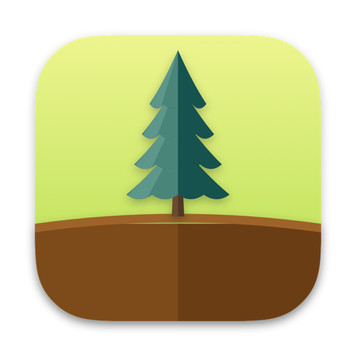
</p>

<h1 align="center">Hábitos</h1>

<p align="center">
  Rastreador de hábitos nativo para macOS em que cada hábito é uma árvore.<br>
  Regue todo dia e veja sua floresta crescer.
</p>

<p align="center">
  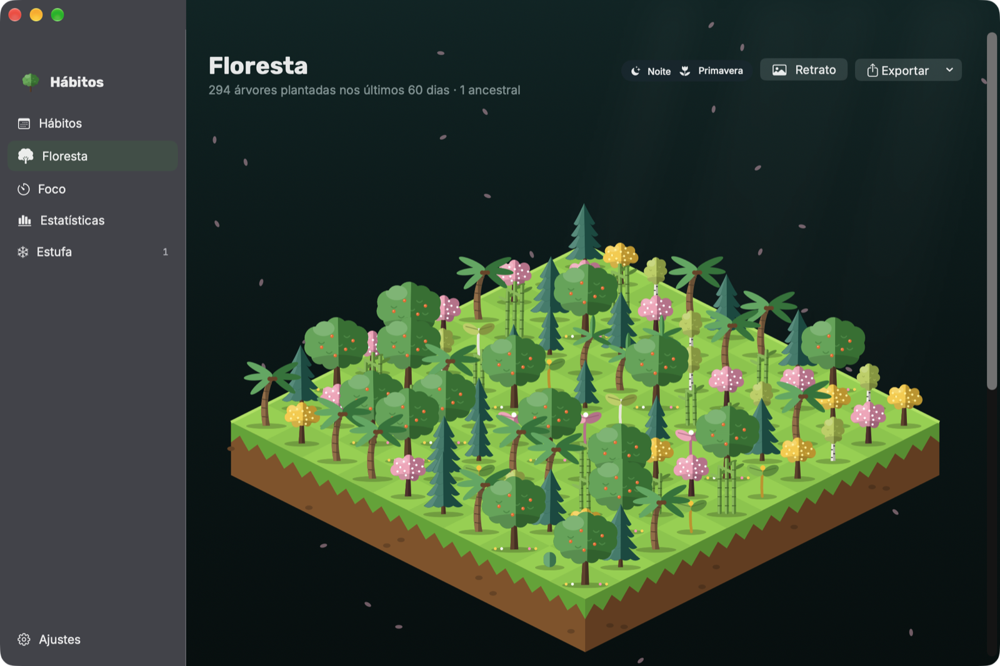
</p>

Feito em Swift com SwiftUI, SwiftData, AppKit, WidgetKit, EventKit, AVFoundation, UserNotifications, App Intents e Swift Charts. Requer macOS 14 ou mais novo.

## Como funciona

Cada hábito é plantado como uma semente. Cada dia regado faz a árvore crescer, e a espécie e a cor são você quem escolhe.

| Sequência | Estágio |
|---|---|
| 0 dias | Semente |
| 1 a 3 | Broto |
| 4 a 14 | Árvore Jovem |
| 15 a 30 | Adulta |
| mais de 30 | Ancestral |

<p align="center">
  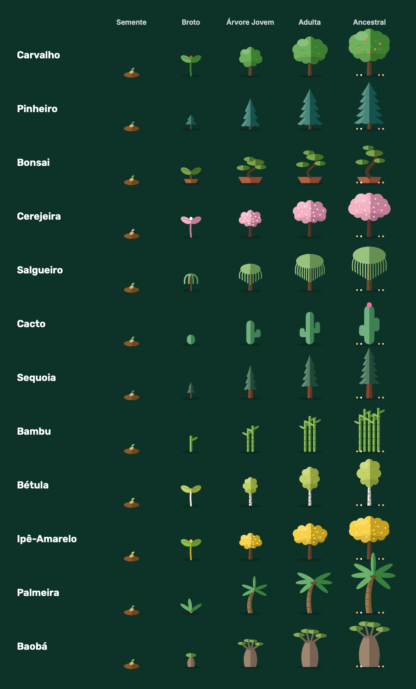
</p>

São **12 espécies**: Carvalho, Pinheiro, Bonsai, Cerejeira, Salgueiro, Cacto, Sequoia, Bambu, Bétula, Ipê-Amarelo, Palmeira e Baobá. Cada uma tem o próprio broto e a própria evolução até a ancestral.

### Saúde da árvore

<p align="center">
  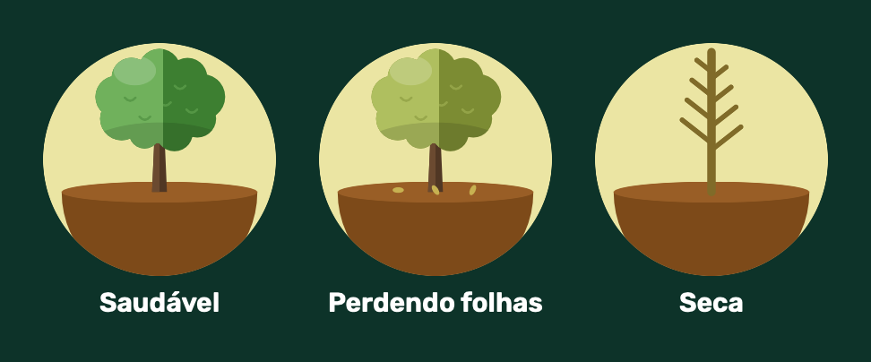
</p>

- **Saudável:** regada em dia.
- **Perdendo folhas:** um dia sem regar. A sequência ainda pode ser salva regando no dia seguinte.
- **Seca:** dois dias seguidos sem regar. A sequência volta a zero.

## Telas

### Hábitos

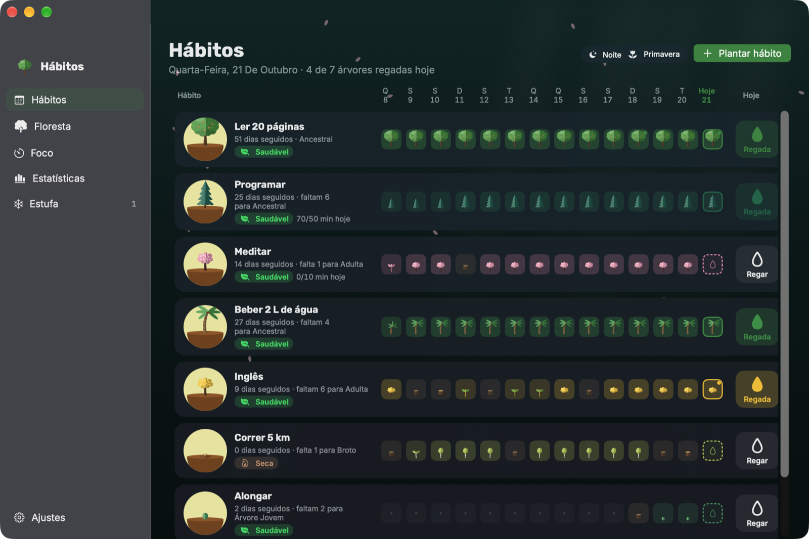

- As últimas **duas semanas** de cada hábito, com a árvore do jeito que estava em cada dia.
- O botão **Regar** marca o dia de hoje. Clicar num dia anterior marca ou desmarca aquele dia.
- Ao regar, abre um campo de **diário** para uma nota de uma linha sobre o dia.
- Clicar na árvore do hábito troca a espécie. O botão direito tem editar, levar para a Estufa e excluir.
- Arraste as linhas para reordenar os hábitos.

### Floresta

A ilha começa vazia e ganha uma árvore a cada dia regado nos últimos 60 dias, no estágio em que ela estava naquele dia. Dias não regados não deixam árvores mortas. Abaixo da ilha ficam os cartões de cada hábito, e um clique rega.

O terreno muda com as estações (o hemisfério é detectado pela região do Mac ou escolhido em Ajustes):

<p align="center">
  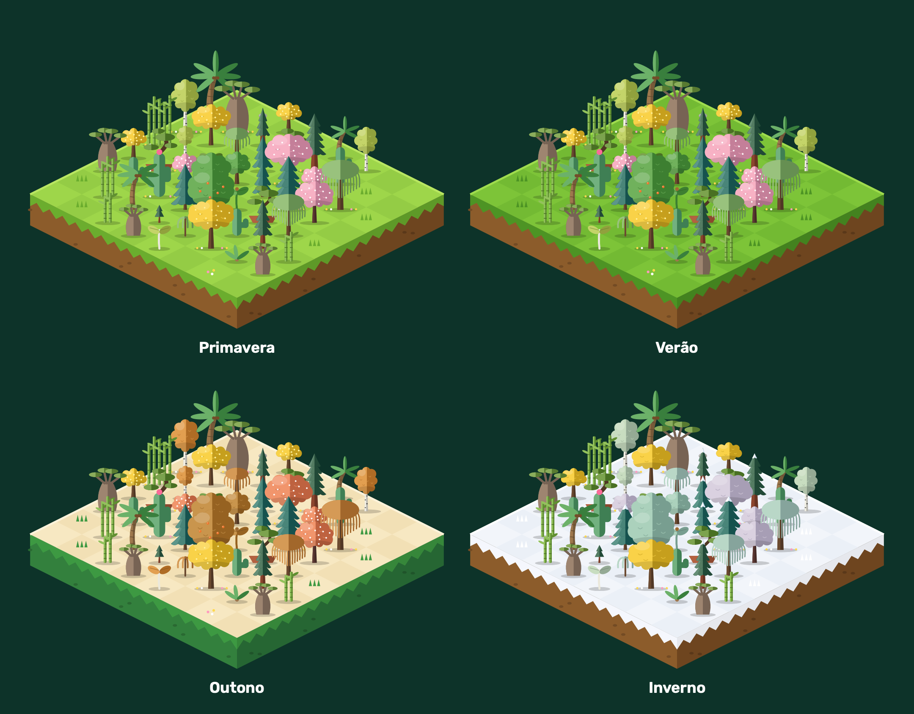
</p>

**Retrato da Floresta** exporta a ilha como PNG, e **Exportar** gera um backup em JSON. Os dois saem pelo menu de compartilhar do macOS (AirDrop, Mensagens, Mail, Notas…).

### Foco

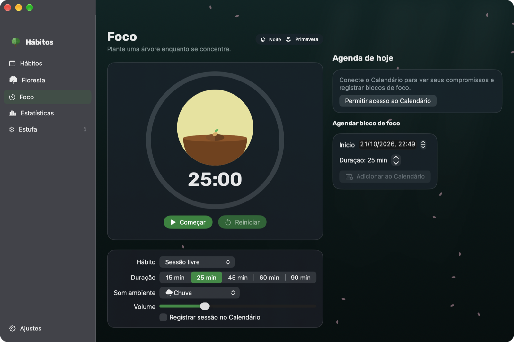

- Temporizador Pomodoro (15, 25, 45, 60 ou 90 minutos, ou a meta do hábito), com uma árvore que cresce durante a sessão.
- **Som ambiente** de chuva, vento ou floresta, gerado em tempo real, sem arquivos de áudio.
- Ao terminar, os minutos entram no hábito e, se a meta diária for atingida, ele é regado.
- Opcionalmente, a sessão vai como bloco de tempo para o **Calendário**. Também dá para agendar blocos futuros e ver a agenda do dia.

### Estatísticas

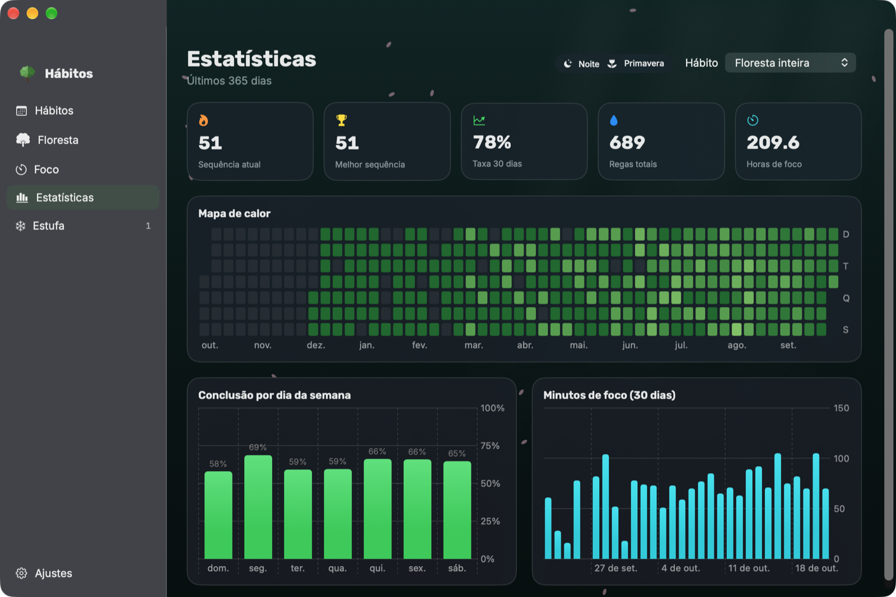

Feitas com Swift Charts:
- **mapa de calor** de 365 dias no estilo do GitHub;
- taxa de conclusão por dia da semana;
- minutos de foco nos últimos 30 dias;
- sequência atual e melhor sequência, taxa dos últimos 30 dias, total de regas e horas de foco.

Dá para ver a floresta inteira ou um hábito só.

### Estufa

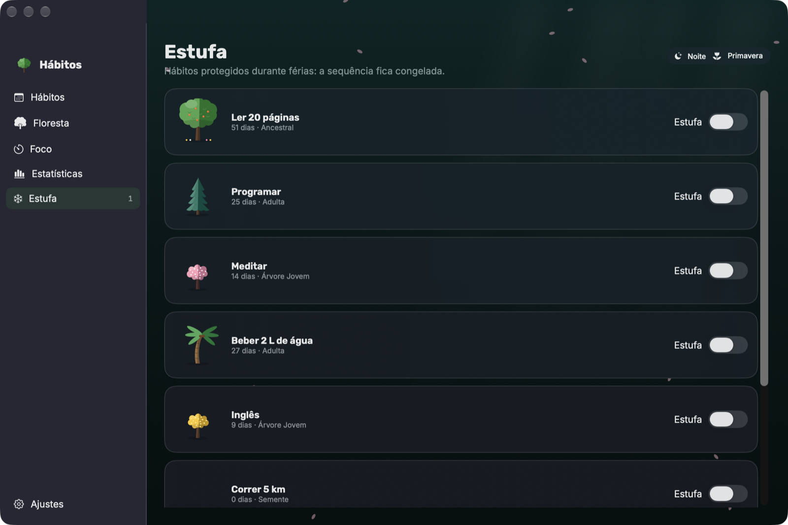

Para férias e pausas: o hábito fica congelado, os dias pausados não contam e não quebram a sequência, nem depois de sair da Estufa.

### Barra de menus

<p align="center">
  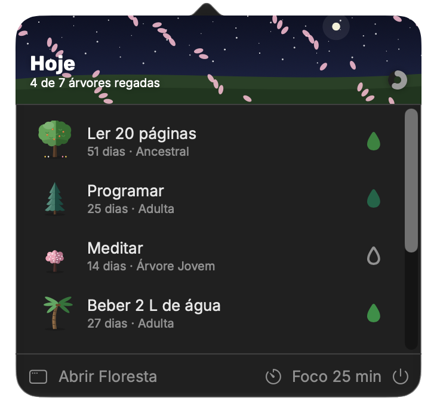
</p>

Um clique na árvore da barra de menus ou **⌘⇧H** de qualquer app abre a lista de hoje para regar rápido, com o progresso do dia e um atalho para uma sessão de foco de 25 minutos. O app continua rodando na barra de menus depois de fechar a janela.

### Widget

<p align="center">
  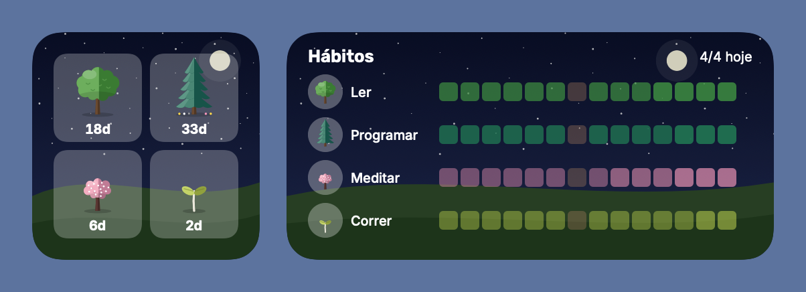
</p>

Widget interativo para a mesa e para a Central de Notificações, em quatro tamanhos. As árvores são botões que regam o hábito sem abrir o app. Os dias mostrados variam com o tamanho: 14 no médio, 21 no grande e 30 no extragrande.

## Integrações com o macOS

| Recurso | Como funciona |
|---|---|
| **Lembretes** | Cada hábito vira **um lembrete recorrente diário** na lista *Hábitos*. O próprio Lembretes cria o lembrete de cada dia, no Mac ou no iPhone, mesmo com o app desligado. Marcar no Lembretes rega a árvore, e regar no app marca o lembrete. O app concilia os últimos 14 dias: na hora, se estiver aberto, ou na próxima abertura. |
| **Notificações** | Lembrete diário por hábito, no horário escolhido, com os botões **Regar Árvore** e **Adiar 15 min** direto no banner. Some nos dias já regados. |
| **Filtros de Foco** | Em Ajustes do Sistema › Foco › Filtros de Foco › Hábitos, cada Foco (Trabalho, Pessoal, Não Perturbe…) pode mostrar só os hábitos daquele contexto e silenciar os lembretes. |
| **Calendário** | Blocos de foco gravados no calendário *Hábitos* e agenda do dia na tela de Foco. |
| **Atalhos e Siri** | Ações *Regar Árvore*, *Iniciar sessão de foco* e *Abrir Floresta*. |
| **Trackpad** | Resposta tátil ao regar, arrastar e terminar uma sessão de foco. |
| **Janela** | Sem bordas e translúcida, com opção de ficar sempre por cima das outras. |
| **Cenário** | A luz do fundo segue o horário (manhã, tarde, pôr do sol, noite), e o clima do dia (chuva, neve, pétalas, folhas, vaga-lumes) aparece em partículas. |
| **Abrir ao iniciar sessão** | Opção em Ajustes › Geral para o app ficar sempre ativo na barra de menus. |
| **Links** | `habitforest://habitos`, `floresta`, `foco`, `estatisticas`, `estufa` e `barra` abrem cada tela. |

## Dados

O banco SwiftData fica no iCloud Drive, em `~/Library/Mobile Documents/com~apple~CloudDocs/HabitForest/`, e acompanha o Mac em reinstalações. Se o iCloud Drive não estiver disponível, ou a opção estiver desligada em Ajustes › Dados, ele vai para `~/Library/Application Support/HabitForest/`.

Por isso o app principal roda **sem App Sandbox**: um app em sandbox não consegue gravar nessa pasta. O widget, que precisa de sandbox, não abre o banco. Ele lê uma cópia leve publicada pelo app num App Group, e os toques no widget entram numa fila que o app aplica ao banco.

Use o banco em um Mac por vez: o iCloud Drive sincroniza o arquivo inteiro e não mescla alterações feitas ao mesmo tempo em dois Macs.

## Como compilar

Requer Xcode 16 ou mais novo (testado no Xcode 27.1) e [XcodeGen](https://github.com/yonaskolb/XcodeGen) para gerar o projeto.

```bash
brew install xcodegen
xcodegen generate
open HabitForest.xcodeproj
```

1. Em **Signing & Capabilities**, escolha seu Team nos alvos `HabitForest` e `HabitForestWidget`, ou preencha `DEVELOPMENT_TEAM` no `project.yml`. O App Group depende de um Team real; sem ele, o widget não enxerga os dados do app.
2. Rode o esquema **HabitForest** (⌘R). O app gerado se chama **Hábitos.app**.

### Modo demonstração

Para testar ou tirar capturas sem mexer nos seus dados:

```bash
open Hábitos.app --args --demo
```

O app abre com uma floresta de exemplo num banco só em memória e não grava nada no banco real, no Lembretes, nas notificações nem no widget. As imagens deste README foram feitas assim.

### Ícone

O ícone é gerado com o mesmo código que desenha as árvores:

```bash
swiftc -parse-as-library -o /tmp/gerar-icone Tools/GerarIcone/main.swift Shared/Core/*.swift Shared/Rendering/*.swift
/tmp/gerar-icone App/Resources/Assets.xcassets/AppIcon.appiconset
```

## Estrutura

```
App/          app principal
  Models/       Habit e HabitLog (SwiftData)
  Store/        HabitStore (todas as alterações passam por aqui) e modo demonstração
  Managers/     notificações, áudio, EventKit, foco, exportação, atalho global, tátil
  Intents/      Filtro de Foco e Atalhos
  Views/        telas em SwiftUI
  Windows/      janela principal e barra de menus (AppKit)
Shared/       compilado no app e no widget
  Core/         sequência e saúde, snapshot do widget, fila de ações, tipografia
  Rendering/    árvores, ilha isométrica e cenário, desenhados em código
  Fonts/        Rubik e Inter (licença OFL)
Widget/       extensão WidgetKit
Tools/        gerador do ícone
docs/imagens/ imagens deste README
project.yml   especificação do XcodeGen
```

## Créditos

- Visual inspirado no app [Forest](https://www.forestapp.cc). Todas as árvores, a ilha e o ícone são desenhados em código neste projeto, sem nenhuma arte do Forest.
- Fontes [Rubik](https://fonts.google.com/specimen/Rubik) e [Inter](https://fonts.google.com/specimen/Inter), sob a [SIL Open Font License](Shared/Fonts/OFL-Rubik.txt).
